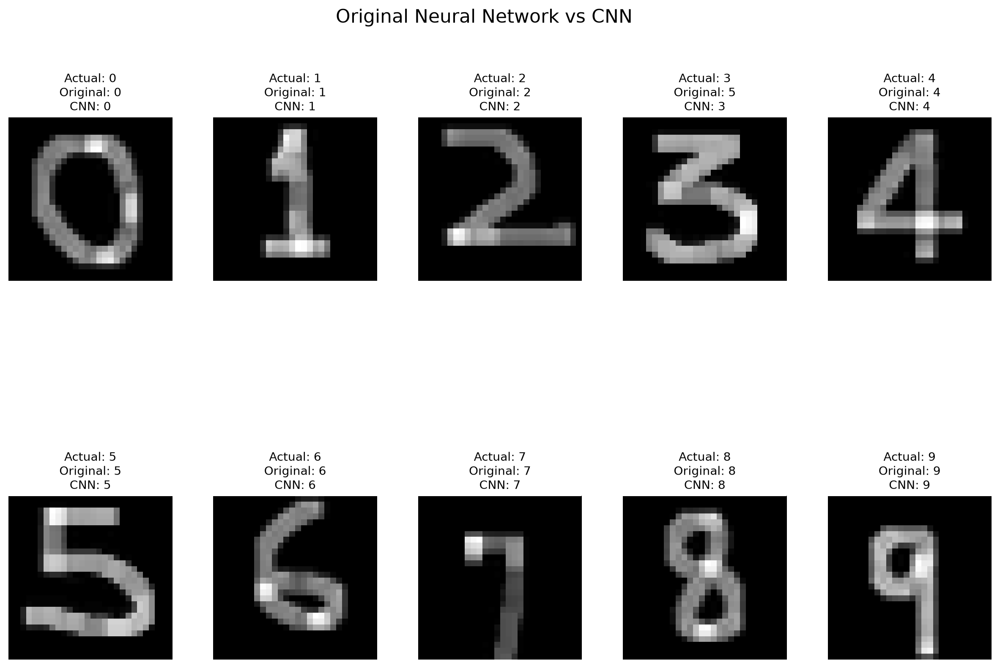

# Handwritten Digit Recognition Using Neural Networks and CNNs

## 1. Project Overview

This project develops a deep learning system that recognises handwritten digits (0–9) using artificial neural networks.

The project uses the MNIST dataset to train and evaluate two different neural network architectures:

1. A Feedforward Neural Network (FFNN).
2. A Convolutional Neural Network (CNN).

Both models are also tested using ten personally handwritten digit images to investigate how well they recognise handwriting outside the original MNIST dataset.

The main objective is to understand how different neural network architectures learn image features, evaluate their performance, and investigate how image preprocessing can improve classification accuracy.

## 2. Technologies Used

- Python
- PyTorch
- Torchvision
- NumPy
- Matplotlib
- Pillow (PIL)
- Scikit-learn
- Git and GitHub

## 3. Dataset

This project uses the MNIST handwritten digit dataset.

The MNIST dataset contains:

- 60,000 training images.
- 10,000 testing images.
- 10 different digit classes (0–9).
- Grayscale images with dimensions of 28 × 28 pixels.

In addition to MNIST, ten personally handwritten digit images were created and stored in:

`data/MNIST/my_digits/`

These images were used to evaluate how well the trained models recognise handwriting outside the original training dataset.

## 4. Data Preprocessing and Augmentation

### Training Data

Data augmentation was applied to the training dataset using:

- Random rotation of up to 10 degrees.
- Random translation of up to 10%.
- Random scaling between 90% and 110%.

The MNIST testing dataset was kept unchanged to provide consistent evaluation.

### Personal Handwriting Preprocessing

The personally handwritten images underwent the following preprocessing steps:

- Conversion to grayscale.
- Background inversion when necessary.
- Cropping around the handwritten digit.
- Resizing while preserving proportions.
- Placement on a 28 × 28 black background.
- Stroke thickening.
- Centre-of-mass alignment.
- Brightness enhancement using a factor of 3.0.
- Conversion into a PyTorch tensor.

During experimentation, the CNN initially achieved 80% accuracy on the ten personal handwriting images.

Further investigation showed that the processed images had relatively low pixel intensities. Increasing their brightness significantly improved the CNN's predictions, resulting in 100% accuracy on the same ten images.

This demonstrated the importance of image preprocessing in machine learning.

## 5. Model Architectures

### Model 1: Feedforward Neural Network (FFNN)

The first model uses a traditional feedforward neural network.

**Architecture:**

- Flatten layer: converts the 28 × 28 image into 784 input values.
- Fully connected layer: 784 to 128 neurons.
- ReLU activation function.
- Output layer: 128 to 10 neurons.

The output layer produces scores for the ten possible digit classes.

### Model 2: Convolutional Neural Network (CNN)

The second model uses convolutional layers to learn visual features from images.

**Architecture:**

- First convolutional layer: 1 input channel and 16 output channels.
- ReLU activation.
- Max pooling.
- Second convolutional layer: 16 input channels and 32 output channels.
- ReLU activation.
- Max pooling.
- Flatten layer.
- Fully connected layer: 1568 to 128 neurons.
- ReLU activation.
- Output layer: 128 to 10 neurons.

The CNN learns visual patterns such as edges, curves and shapes that help distinguish handwritten digits.

## 6. Training Configuration

Both models use the following main training configuration:

| Parameter | Value |
|---|---|
| Dataset | MNIST |
| Batch size | 64 |
| Learning rate | 0.001 |
| Optimizer | Adam |
| Loss function | CrossEntropyLoss |
| Device | CPU |

**Training epochs:**

| Model | Epochs |
|---|---:|
| Feedforward Neural Network | 5 |
| Convolutional Neural Network | 10 |

## 7. Model Evaluation and Results

The models were evaluated using two datasets:

1. The official MNIST test dataset containing 10,000 images.
2. Ten personally handwritten digit images.

Evaluation included accuracy, confusion matrices, precision, recall and F1-score.

### 7.1 MNIST Test Results

| Model | Test Accuracy |
|---|---:|
| Feedforward Neural Network | 96.79% |
| Convolutional Neural Network | 98.88% |

The CNN achieved higher accuracy on the official MNIST test dataset.

### 7.2 Personal Handwriting Results

After applying the same brightness-enhanced preprocessing to both models, the results were:

| Model | Correct Predictions | Accuracy |
|---|---:|---:|
| Feedforward Neural Network | 9/10 | 90% |
| CNN | 10/10 | 100% |

The feedforward neural network incorrectly classified the handwritten digit 3 as 5.

The CNN correctly classified all ten handwritten test images.

**Important:** The personal handwriting evaluation contains only ten images. The 100% accuracy applies only to these ten samples and does not establish general performance on unseen handwriting.

### 7.3 Preprocessing Experiment

One of the important experiments involved improving the brightness of the processed handwritten images.

| CNN Experiment | Correct Predictions | Accuracy |
|---|---:|---:|
| Before brightness enhancement | 8/10 | 80% |
| After brightness enhancement | 10/10 | 100% |

The brightness enhancement factor of 3.0 helped the CNN recognise handwritten digits that it previously misclassified, particularly digits 4 and 8.

This experiment demonstrated that improving input data quality can significantly affect model predictions without changing the trained model architecture or weights.

## 8. Visual Model Comparison

The following image shows the predictions made by both models on the ten personally handwritten digits.



The comparison shows that the CNN correctly classified all ten handwritten images, while the original feedforward neural network made one incorrect prediction.

## 9. Project Structure

```text
01-Handwritten-Digit-Recognition/
│
├── data/
│   └── MNIST/
│       ├── my_digits/
│       │   ├── test_0.png
│       │   ├── test_1.png
│       │   ├── test_2.png
│       │   ├── test_3.png
│       │   ├── test_4.png
│       │   ├── test_5.png
│       │   ├── test_6.png
│       │   ├── test_7.png
│       │   ├── test_8.png
│       │   └── test_9.png
│       │
│       └── raw/
│
├── models/
│   ├── digit_recognition.pth
│   └── cnn_digit_recognition.pth
│
├── notebooks/
│
├── results/
│   └── model_comparison.png
│
├── src/
│   ├── download_data.py
│   ├── explore_data.py
│   ├── train.py
│   ├── train_cnn.py
│   ├── predict.py
│   ├── predict_cnn.py
│   └── compare_models.py
│
├── .gitignore
└── README.md
└── requirements.txt


```

## 10. How to Run the Project

### Step 1: Clone the repository

```bash
git clone https://github.com/uchecyril500/Handwritten-digit-recognition.git
```

### Step 2: Enter the project directory

```bash
cd Handwritten-digit-recognition
```

### Step 3: Create a virtual environment

```bash
python -m venv .venv
```

### Step 4: Activate the virtual environment

For Windows PowerShell:

```powershell
.\.venv\Scripts\Activate.ps1
```

### Step 5: Install the required libraries**

Install all project dependencies using the `requirements.txt` file:

```bash
pip install -r requirements.txt
```


### Step 6: Download the MNIST dataset

```bash
python src/download_data.py
```

### Step 7: Train the original feedforward neural network

```bash
python src/train.py
```

### Step 8: Train the CNN

```bash
python src/train_cnn.py
```

### Step 9: Run digit predictions

To test the original neural network:

```bash
python src/predict.py
```

To test the CNN:

```bash
python src/predict_cnn.py
```

### Step 10: Compare both models

```bash
python src/compare_models.py
```

The comparison script evaluates both models on the ten personal handwriting images and generates a visual report in the `results/` directory.

## 11. What I Learned

Through this project, I gained practical experience in:

- Loading and exploring image datasets.
- Preparing images for machine learning.
- Applying data augmentation.
- Building neural networks using PyTorch.
- Understanding feedforward neural networks and CNNs.
- Training and evaluating deep learning models.
- Using confusion matrices and classification reports.
- Comparing different neural network architectures.
- Testing models using personally created images.
- Investigating incorrect predictions.
- Improving image preprocessing to increase prediction accuracy.
- Understanding the importance of input data quality.
- Using Git and GitHub to manage and publish machine learning projects.

## 12. Conclusion

This project demonstrates the development, training and evaluation of two deep learning models for handwritten digit recognition.

The CNN achieved 98.88% accuracy on the official MNIST test dataset, compared with 96.79% for the feedforward neural network.

On the ten personally handwritten images, the CNN achieved 100% accuracy, while the feedforward neural network achieved 90% after applying the same preprocessing.

An important finding was that brightness enhancement significantly improved the CNN's recognition of personal handwriting without requiring changes to the trained model.

Overall, this project provided practical experience in the machine learning workflow, from data preparation and model development to training, evaluation, experimentation, visualisation and version control.

It also demonstrated how neural network architecture and input preprocessing can influence the performance of an image classification system.

---

**Project:** AI Engineering Portfolio — Project 01  
**Topic:** Handwritten Digit Recognition  
**Framework:** PyTorch  
**Programming Language:** Python  
**Repository:** [GitHub – Handwritten Digit Recognition](https://github.com/uchecyril500/Handwritten-digit-recognition)