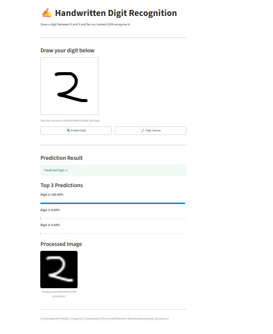

# ✍️ Handwritten Digit Recognition Using Deep Learning

An AI Engineering portfolio project that uses **PyTorch, Feedforward Neural Networks (FFNN), and Convolutional Neural Networks (CNN)** to recognise handwritten digits from 0 to 9.

The project includes model training, evaluation, image preprocessing, model comparison, and an interactive web application built with Streamlit.

<p align="center">

**[🚀 TRY THE LIVE APPLICATION](https://handwritten-digit-recognition-3d1n.onrender.com)**

</p>

## Live Application Preview



*The application correctly recognises a handwritten digit using the trained CNN model.*

**Built and Designed by [@uchecyril](https://github.com/uchecyril500)**

---

## 1. Project Overview

The objective of this project is to develop a deep learning system capable of recognising handwritten digits (0–9).

Two neural network architectures were developed and compared:

1. **Feedforward Neural Network (FFNN)**
2. **Convolutional Neural Network (CNN)**

Both models were trained and evaluated using the MNIST handwritten digit dataset.

In addition, personally handwritten digit images were used to investigate how well the trained models perform on handwriting outside the original dataset.

The project also includes an interactive Streamlit application where users can draw a digit and receive a prediction from the trained CNN.

The main focus was to understand the machine learning workflow, from data preparation and model development to training, evaluation, experimentation, application development, and deployment.

## 2. Technologies and Tools

| Technology | Purpose |
|---|---|
| Python | Main programming language |
| PyTorch | Neural network development and training |
| Torchvision | MNIST dataset and image transformations |
| NumPy | Numerical operations |
| Matplotlib | Data visualisation |
| Pillow (PIL) | Image processing |
| Scikit-learn | Model evaluation and classification metrics |
| Streamlit | Interactive web application |
| Streamlit Drawable Canvas | Handwriting input |
| Git and GitHub | Version control and project hosting |
| Render | Application deployment and hosting |
| VS Code | Development environment |

## 3. Dataset

This project uses the **MNIST handwritten digit dataset**.

The dataset contains:

- 60,000 training images.
- 10,000 testing images.
- 10 digit classes (0–9).
- Grayscale images.
- Image dimensions of 28 × 28 pixels.

In addition to MNIST, ten personally handwritten digit images were created and stored in:

`data/MNIST/my_digits/`

These images were used to evaluate the models on handwriting outside the original MNIST dataset.

## 4. Data Preprocessing and Augmentation

### 4.1 Training Data Augmentation

The following transformations were applied to the training images:

- Random rotation of up to 10 degrees.
- Random translation of up to 10%.
- Random scaling between 90% and 110%.
- Conversion into PyTorch tensors.

The official MNIST testing dataset was kept unchanged for evaluation.

### 4.2 Personal Handwriting Preprocessing Experiment

Additional preprocessing was investigated to prepare personally handwritten images for CNN prediction.

The experimental preprocessing included:

1. Conversion to grayscale.
2. Background inversion when necessary.
3. Cropping around the handwritten digit.
4. Resizing while preserving proportions.
5. Placement on a 28 × 28 black canvas.
6. Stroke thickening.
7. Centre-of-mass alignment.
8. Brightness enhancement using a factor of 3.0.
9. Conversion into a PyTorch tensor.

### 4.3 Preprocessing Experiment Results

During experimentation, the CNN initially achieved 80% accuracy on the ten personal handwriting images.

Further investigation showed that the processed images had relatively low pixel intensities.

Applying brightness enhancement significantly improved the predictions, resulting in 100% accuracy on the same ten images.

This experiment demonstrated that image preprocessing can have a significant effect on machine learning predictions without changing the trained model architecture or weights.

**Note:** The brightness-enhanced preprocessing described above belongs to the personal handwriting experiment. The current interactive Streamlit application uses a simpler preprocessing pipeline, including grayscale conversion, background inversion when necessary, cropping, resizing, placement on a 28 × 28 canvas, and centre-of-mass alignment. It does not apply the experimental stroke thickening or brightness enhancement.

## 5. Model Architectures

### 5.1 Feedforward Neural Network (FFNN)

The first model uses a traditional feedforward neural network.

**Architecture:**

- Flatten layer: 784 input features.
- Fully connected layer: 784 → 128 neurons.
- ReLU activation.
- Output layer: 128 → 10 neurons.

The output layer produces scores for the ten possible digit classes.

### 5.2 Convolutional Neural Network (CNN)

The second model uses convolutional layers to learn visual features from handwritten images.

**Architecture:**

- Convolutional layer: 1 → 16 channels.
- ReLU activation.
- Max pooling.
- Convolutional layer: 16 → 32 channels.
- ReLU activation.
- Max pooling.
- Flatten layer.
- Fully connected layer: 1568 → 128 neurons.
- ReLU activation.
- Output layer: 128 → 10 neurons.

The CNN learns visual patterns such as edges, curves, and shapes that help distinguish handwritten digits.

## 6. Model Training Configuration

Both models use the following main training configuration:

| Parameter | Value |
|---|---|
| Dataset | MNIST |
| Batch size | 64 |
| Learning rate | 0.001 |
| Optimizer | Adam |
| Loss function | CrossEntropyLoss |
| Device | CPU |

**Training epochs:**

| Model | Epochs |
|---|---:|
| Feedforward Neural Network | 5 |
| Convolutional Neural Network | 10 |

The trained model weights are saved in the `models/` directory.

## 7. Model Evaluation and Results

The models were evaluated using:

1. The official MNIST test dataset containing 10,000 images.
2. Ten personally handwritten digit images.

Evaluation included accuracy, confusion matrices, precision, recall, and F1-score.

### 7.1 MNIST Test Results

| Model | Test Accuracy |
|---|---:|
| Feedforward Neural Network | 96.79% |
| Convolutional Neural Network | 98.88% |

The CNN achieved higher accuracy than the FFNN on the official MNIST test dataset.

### 7.2 Personal Handwriting Results

After applying the same brightness-enhanced preprocessing to both models:

| Model | Correct Predictions | Accuracy |
|---|---:|---:|
| Feedforward Neural Network | 9/10 | 90% |
| CNN | 10/10 | 100% |

The FFNN incorrectly classified one handwritten digit, while the CNN correctly classified all ten images.

**Important:** The personal handwriting evaluation contains only ten images. The 100% accuracy applies only to these ten samples and does not establish general performance on unseen handwriting.

### 7.3 Interactive Application Testing

The deployed application was tested manually using different handwritten digits, sizes, and drawing styles.

Testing included:

- All ten digit classes, from 0 to 9.
- Live predictions using the deployed application.
- Display of the top three prediction probabilities.
- Display of the processed image.
- Clearing the drawing canvas.
- Empty-canvas validation.

The application correctly recognised the tested digit classes during the manual demonstrations.

These manual demonstrations are separate from the formal MNIST evaluation and the ten-image personal handwriting experiment. They do not represent a formal accuracy benchmark.

## 8. Visual Model Comparison

The following image compares the predictions made by the FFNN and CNN on the ten personally handwritten digit images.


The comparison demonstrates the improved performance of the CNN on the personal handwriting samples.

## 9. Interactive Streamlit Application

A web-based application was developed using Streamlit to allow users to interact with the trained CNN model.

### Try the Live Application

**[🚀 Open Handwritten Digit Recognition](https://handwritten-digit-recognition-3d1n.onrender.com)**

The application is publicly accessible through Render.

### Application Features

- Draw handwritten digits using a mouse or touchscreen.
- Predict digits between 0 and 9.
- Display the predicted digit.
- Display the top three prediction probabilities.
- Show confidence scores for the predictions.
- Display the processed image used by the CNN.
- Clear the drawing canvas and try another digit.
- Display an error message when the user attempts to predict an empty canvas.

### Application Workflow

1. The user draws a digit on the canvas.
2. The application retrieves the drawing.
3. The CNN prediction engine preprocesses the image.
4. The processed image is converted into a PyTorch tensor.
5. The trained CNN generates prediction scores.
6. Softmax converts the scores into probabilities.
7. The application displays the predicted digit and top three results.

The application uses the previously trained CNN model. It does not retrain the model every time a user makes a prediction.

### Application Deployment

The application was deployed using **Render**, connected directly to the GitHub repository.

| Deployment Detail | Value |
|---|---|
| Hosting platform | Render |
| Source repository | GitHub |
| Branch | main |
| Main application file | app.py |
| Python version | 3.13 |
| Framework | Streamlit |
| Model | Trained CNN |
| Deployment status | Successfully deployed and tested |

**Permanent live application URL:**

https://handwritten-digit-recognition-3d1n.onrender.com

### Run the Application Locally

Run the application using:

```bash
python -m streamlit run app.py
```

The application will open in your web browser.

Draw a digit, click **Predict Digit**, and view the CNN prediction.

## 10. Project Structure

```text
01-Handwritten-Digit-Recognition/
│
├── data/
│   └── MNIST/
│       ├── my_digits/
│       │   ├── test_0.png
│       │   ├── test_1.png
│       │   ├── test_2.png
│       │   ├── test_3.png
│       │   ├── test_4.png
│       │   ├── test_5.png
│       │   ├── test_6.png
│       │   ├── test_7.png
│       │   ├── test_8.png
│       │   └── test_9.png
│       │
│       ├── raw/
│       └── processed/
│
├── models/
│   ├── digit_recognition.pth
│   └── cnn_digit_recognition.pth
│
├── notebooks/
│
├── results/
│   └── model_comparison.png
│
├── src/
│   ├── download_data.py
│   ├── explore_data.py
│   ├── train.py
│   ├── train_cnn.py
│   ├── predict.py
│   ├── predict_cnn.py
│   ├── cnn_predictor.py
│   └── compare_models.py
│
├── app.py
├── requirements.txt
├── .python-version
├── .gitignore
└── README.md
```

## 11. How to Install and Run the Project

### Prerequisites

- Python 3.13 or a compatible Python version.
- Git installed.
- Internet connection for downloading the MNIST dataset and installing dependencies.

### Step 1: Clone the repository

```bash
git clone https://github.com/uchecyril500/Handwritten-digit-recognition.git
```

### Step 2: Enter the project directory

```bash
cd Handwritten-digit-recognition
```

### Step 3: Create a virtual environment

```bash
python -m venv .venv
```

### Step 4: Activate the virtual environment

For Windows PowerShell:

```powershell
.\.venv\Scripts\Activate.ps1
```

### Step 5: Install the required dependencies

```bash
python -m pip install -r requirements.txt
```

### Step 6: Download the MNIST dataset

```bash
python src/download_data.py
```

### Step 7: Train the Feedforward Neural Network

```bash
python src/train.py
```

### Step 8: Train the Convolutional Neural Network

```bash
python src/train_cnn.py
```

### Step 9: Run digit predictions

To test the FFNN:

```bash
python src/predict.py
```

To test the CNN:

```bash
python src/predict_cnn.py
```

### Step 10: Compare both models

```bash
python src/compare_models.py
```

The comparison script evaluates both models on the personal handwriting images and generates a visual report in the `results/` directory.

### Step 11: Launch the interactive web application

```bash
python -m streamlit run app.py
```

The application will open in your default web browser.

**Note:** The trained model files are included in the project repository. If they are unavailable in a fresh checkout, run the relevant training scripts to generate them.

## 12. What I Learned

Through this project, I gained practical experience in:

- Loading and exploring image datasets.
- Preparing images for machine learning.
- Applying data augmentation.
- Building neural networks using PyTorch.
- Understanding feedforward neural networks and CNNs.
- Training and evaluating deep learning models.
- Using confusion matrices and classification reports.
- Comparing different neural network architectures.
- Testing models with personally created images.
- Investigating incorrect predictions.
- Improving image preprocessing.
- Understanding the importance of input data quality.
- Building an interactive machine learning application with Streamlit.
- Integrating a trained model into a user-facing application.
- Deploying a machine learning application using Render.
- Using Git and GitHub for version control.

## 13. Conclusion

This project demonstrates the development, training, evaluation, and practical application of two deep learning models for handwritten digit recognition.

The CNN achieved 98.88% accuracy on the official MNIST test dataset, compared with 96.79% for the FFNN.

On the ten personally handwritten images, the CNN achieved 100% accuracy, while the FFNN achieved 90% using the same preprocessing.

An important finding was that brightness enhancement significantly improved the CNN's recognition of personal handwriting without requiring changes to the trained model architecture or weights.

The project also demonstrates how a trained deep learning model can be integrated into an interactive application that allows users to test its predictions.

Finally, deploying the application on Render made the project accessible beyond the local development environment.

Overall, this project provided practical experience across the machine learning workflow, from data preparation and model development to experimentation, evaluation, visualisation, application development, deployment, and version control.

---

## Project Information

| Field | Details |
|---|---|
| Portfolio | AI Engineering Portfolio |
| Project | Project 01 |
| Topic | Handwritten Digit Recognition |
| Programming Language | Python |
| Deep Learning Framework | PyTorch |
| Application Framework | Streamlit |
| Deployment Platform | Render |
| Models | FFNN and CNN |
| Dataset | MNIST |
| Developer | @uchecyril |
| GitHub | [Handwritten Digit Recognition](https://github.com/uchecyril500/Handwritten-digit-recognition) |
| Live Application | [Try the application](https://handwritten-digit-recognition-3d1n.onrender.com) |

**Built and Designed by [@uchecyril](https://github.com/uchecyril500)**